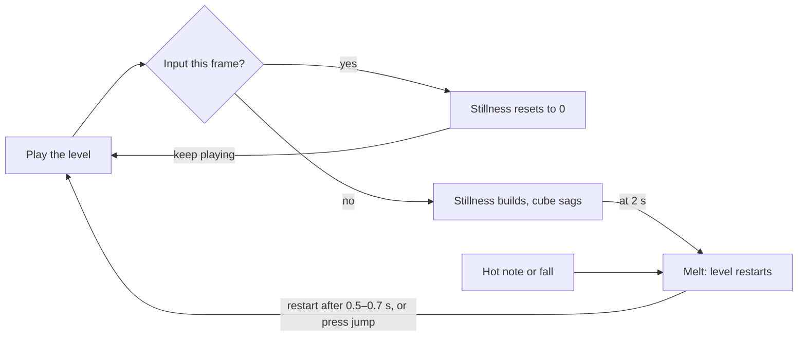
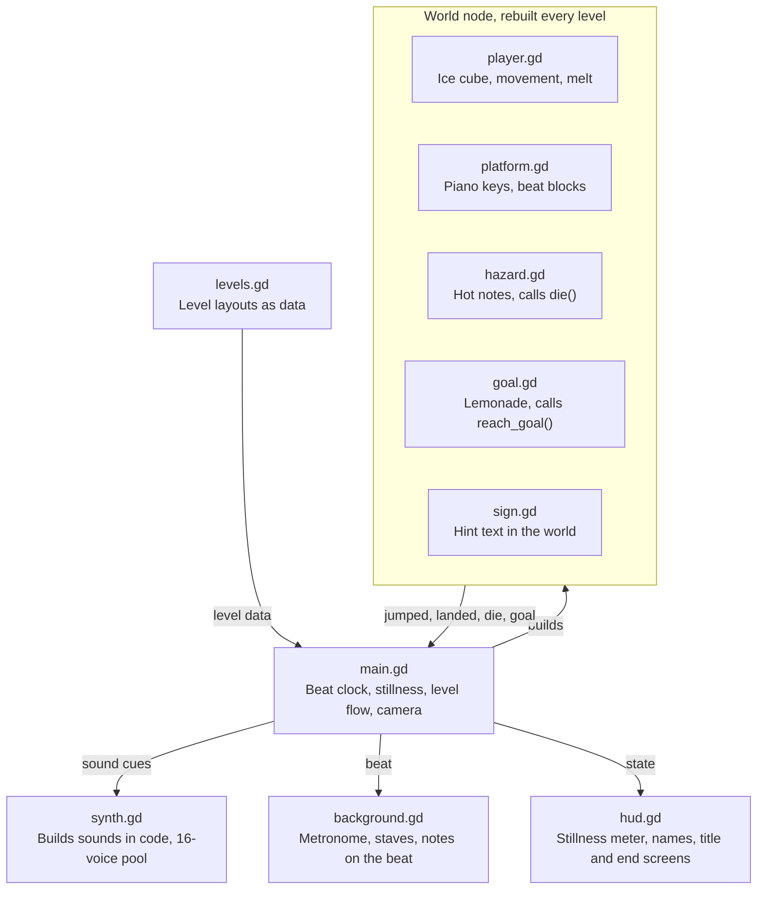

# Meltronome — Game Design Document

Oct 11, 2026 · @Lazy

> Exported from the live doc: <https://claude.ai/code/artifact/1bff46ee-b478-43ed-b8b8-08224e86088a>. The live version is the source of truth; status dropdowns and comments live there.

## Overview

Meltronome is a 2D rhythm-platformer: you are an ice cube at a surreal concert, and if you stop pressing for 2 seconds you melt and the level restarts.

| Item | Detail |
| --- | --- |
| Jam | OctAIJam, 4-hour build, solo developer |
| Theme | Surreal; you can't stop for more than 2 seconds or the level resets |
| Engine | Godot 4 (GDScript), GL Compatibility renderer |
| Platforms | Windows, macOS, Linux; run locally, no submission |
| Assets | All art and audio generated in code; AI code and assets allowed |
| Status | Finished: 6 levels, title and end screens with best times; every block done, including exported builds for Windows, macOS and Linux |

The goal for the rest of the jam is to turn the prototype into a tight, finished-feeling 10-minute experience rather than to add breadth.

## Design pillars

Every feature must serve at least one of these four pillars; anything that serves none is cut.

1. **Never stop.** Stillness is the only enemy. Every mechanic should push the player to keep inputting, and should never trap them with nothing to do.
2. **Play the music.** Movement is performance: jumps make notes, the world moves on the beat, and a good run sounds good.
3. **Readable surrealism.** The world is strange (piano keys, a giant metronome, a lemonade finish line) but every rule is shown on screen, never hidden.
4. **Fail fast, retry instantly.** A death costs 0.5–0.7 seconds (or less: press jump to skip) and restarts the current level, so experimenting is cheap.

## Core loop and the stillness rule

Second to second, the player reads the next jump, times it to the beat, and never lets go of every key for 2 seconds.

Input means any key, mouse button or gamepad button held or pressed, or a stick pushed past halfway. The stillness clock pauses during death, win and menu screens. Reaching the lemonade moves you to the next level; after level IV comes the end screen.

## Player character and controls

The player is a 36 px ice cube that slides and jumps; its only ability is a variable-height jump, and its face and shape show how close it is to melting.

**Movement tuning** (in `scripts/player.gd`)

| Parameter | Value | Effect |
| --- | --- | --- |
| Run speed | 340 px/s | Crosses the 1280 px screen in about 3.8 s |
| Ground accel / friction | 2600 / 3200 px/s² | Snappy starts and stops |
| Air accel | 1700 px/s² | Some air control, less than on the ground |
| Gravity | 1700 px/s² | Fall speed capped at 1300 px/s |
| Jump velocity | 640 px/s | Full jump about 120 px high, 250 px long |
| Jump cut | velocity × 0.5 on release | Tap for a short hop, hold for full height |
| Coyote time | 0.10 s | Jump still works just after leaving a ledge |
| Jump buffer | 0.12 s | A press just before landing still jumps |

**Bindings**

| Action | Keyboard | Gamepad |
| --- | --- | --- |
| Move | Arrows, A / D | D-pad, left stick |
| Jump | Space, W, Up, Z | A |
| Mute | M | Back |
| Fullscreen | F11 | — |
| Quit | Esc | — |

**Melt feedback:** as stillness builds, the cube shrinks, widens, drips, shakes and switches from a smile to a frown. Pressing anything snaps it back to solid.

## Mechanics and level elements

A global beat clock at 100 BPM (0.6 s per beat) drives the music and the world; it never stops, even through deaths and level changes.

| Element | Status | Behaviour | Teaches |
| --- | --- | --- | --- |
| Piano-key ground | Built | Solid; thin pieces (24–30 px) are one-way, so you can jump up through them | Basic platforming |
| Beat blocks (blue / pink) | Built | Colours take turns being solid (4 beats each on level II, 2 elsewhere); in the last 30% of a turn the outgoing colour blinks and the incoming one is already solid, so both overlap; one-way | Moving in time with the music |
| Hot notes | Built | Touching one melts you instantly | Precision; a cost for panicking |
| Fall-out | Built | Dropping below the level resets it | Gaps matter |
| Lemonade glass | Built | Goal; diving in ends the level with a splash and an arpeggio | Clear destination |
| Hint signs | Built | Text placed in the world | Rules without a tutorial screen |
| Pendulum platform | Built | Brass slab on a rod from a bolted ceiling beam, swinging with the metronome (optionally at half speed); a dotted arc shows its path | Riding the beat |
| Heat lamp | Built | Amber stage lamp; under its light cone stillness fills twice as fast (1 s melt); input still resets | Pressure to keep moving through |
| Tempo change | Built | Later levels raise the BPM (100 → 120 → 140) | Difficulty curve without new rules |
| Refreezer (snowflake) | Built | Pickup; holding one (max one) cancels the next stillness melt with a refreeze, "Refrozen!" and a chime; hazards and falls still kill | A rare chance to pause and plan |

Beat-block timing at 100 BPM: a 2-beat turn lasts 1.2 s with a 0.36 s overlap; a 4-beat turn lasts 2.4 s with a 0.72 s overlap. A full jump takes about 0.75 s, so a jump started in the overlap always lands on solid ground.

## Level design

Each level introduces one idea, then tests it once in combination. Levels are named after musical terms, and all level data lives in `scripts/levels.gd`.

| # | Name | New idea | Built | Target length |
| --- | --- | --- | --- | --- |
| I | Allegro | Moving, jumping, the 2-second rule | Yes | 30 s |
| II | Syncopation | Beat blocks: same-colour pairs first, alternating only at the end | Yes | 45 s |
| III | Fortissimo | Hot notes plus beat blocks over a fire pit | Yes | 60 s |
| IV | Da Capo | Vertical climb on mixed blocks | Yes | 45 s |
| V | Accelerando | Six half-speed pendulums, tempo 100 → 120 → 140, then a vertical climb over beat blocks | Yes | 60 s |
| VI | Finale | Everything at once: beat blocks over fire, heat lamps over waiting spots, two pendulum chains, hot keys, a climb; 120 → 130 → 140 BPM; two snowflakes | Yes | 60–90 s |

**Design rules**

- Horizontal gaps: 120 px at most (full jump reach is about 250 px).
- Rises: 90 px at most (full jump height is about 120 px).
- Every beat-block section must be passable by **waiting while holding a key**, so the player is never forced to stop.
- No blind jumps: the camera leads 180 px in the direction of travel, and every landing must be on screen before the jump.
- Each level should be finishable in under 90 s by a player who knows it.

## Audio and music

All sound is synthesized at startup by `scripts/synth.gd` (22 kHz, 16-voice pool), and the player's jumps write the melody over a fixed I–vi–IV–V loop in C major.

| Sound | Trigger | Built | Notes |
| --- | --- | --- | --- |
| Metronome tick | Every beat | Yes | Accented, higher pitch on beat 1 of each bar |
| Bass | Beat 1 of each bar | Yes | Triangle wave, root of C / Am / F / G |
| Jump note | Each jump | Yes | Next tone of the current chord, climbing over two octaves |
| Land thud | Touching the ground | Yes | Short low sweep |
| Melt | Death by stillness | Yes | Descending wobble |
| Sizzle | Death by hot note | Yes | Noise burst |
| Win arpeggio | Reaching the goal | Yes | Six chord tones, 90 ms apart |
| Stillness warning | Stillness past 1 s | Yes | Drips every 0.35 s at 1 s, down to 0.08 s, pitch 900 to 1300 Hz |
| Pad | Beat 1 of each bar | Yes | Three chord tones around middle C at -18 dB, own 6-voice pool, pre-rendered at startup |
| Mute | M key, gamepad Back | Yes | Mutes the Master bus; "Muted (M)" shown bottom right |

## Art direction and UI

The look is flat, code-drawn shapes on a dark purple concert hall, and colour always carries meaning: ice blue is you, blue and pink are the beat, and red is danger.

| Colour | Hex | Meaning |
| --- | --- | --- |
| Night purple | #17122b | Background, the concert hall |
| Ivory / ink | #efe9dc / #1a1424 | Piano-key ground, always safe |
| Ice blue | #b8edff | The player |
| Cyan | #38e0ff | Beat block group A |
| Magenta | #ff4fd8 | Beat block group B |
| Red-orange | #ff5a3c | Hazards, the stillness warning |
| Lemon | #ffe27a | The goal and wins |

**Backgrounds (per level, `"bg"` key):** hall (I, title, end), night-blue stage lights that alternate on the beat (II), maroon glow with rising embers (III), teal organ pipes and repeat signs with vertical parallax (IV), brass dusk with speed streaks that follow the BPM and no metronome (V), crimson curtain, footlights and gold confetti (VI). All stay faint so platforms read first. A small metronome in the top-right corner swings to an extreme on every tick, behind music staves and floating notes that pulse on the beat, with slight parallax. It used to be large and centred, but in playtesting its arm was confused with the pendulum platforms, so it moved out of the play area.

**HUD**

- Top left: the level name. Top right: level number and melt count.
- Bottom centre: a stillness meter on a dark panel that fills from ice blue to red, with "KEEP MOVING!" flashing past 50% and "UNDER THE LAMP" with a warm outline under a heat lamp.
- A red screen tint builds past 40% stillness.
- Centre messages for level names, death reasons and "Bravo!".

**Screens:** a title screen (name, premise, controls) and an end screen ("FINE", total melts, press Space to replay). The end screen dims the level and lists this run's time and the best time per level, plus a total; bests are saved to `user://best_times.cfg`. The play HUD shows the BPM under the level name and the attempt timer at top right.

## Technical design

The game is one scene (`scenes/main.tscn`) whose `main.gd` builds everything in code; there are no other scenes and no asset files.

Beat blocks poll `main.beat_group_active()` each frame. The background and HUD sit on their own canvas layers (behind and in front of the world).

**Cross-platform notes**

- GL Compatibility renderer: works on older GPUs and on macOS without Vulkan.
- Physical key codes, so WASD stays in place on AZERTY keyboards.
- Runs with `godot --path .` on any OS. Exports need Godot's export templates (block C5).
- Scripts use `preload` instead of `class_name`, so the project runs without an editor import step.

## Scope and schedule

The core game is done; the remaining time goes first to making the four existing levels feel good, and only then to new content.

**Done:** core loop, movement, beat clock, beat blocks, hazards, goal, procedural audio, background, HUD, title and end screens, 4 levels.

**Must (polish what exists, about 70 min)**

- Hands-on playtest of levels I–IV, then retune gaps and beat-block timing.
- Stillness warning drips, plus a mute toggle.
- Quick restart feel: shorten the death delay if 1.1 s feels slow.

**Should (new content, about 100 min)**

- Pendulum platforms and tempo change.
- Level V, Accelerando.
- Best time per level.

**Could (only if ahead)**

- Heat lamps, the refreezer pickup and level VI, Finale.
- Pad / chord layer in the music.
- Per-level backgrounds.
- Exported builds for Windows, macOS and Linux.

Reserve the last 20 minutes for a full playthrough and a final commit; nothing new starts after that point.

## Work breakdown

The remaining work splits into 14 blocks of 10–40 minutes, each small enough to finish, test and commit on its own. Work top to bottom; a block starts only when everything it depends on is Done.

| ID | Block | Tier | Est. (min) | Depends on | Done when | Status |
| --- | --- | --- | --- | --- | --- | --- |
| A1 | Playtest and retune levels I–IV | Must | 30 | — | You clear every level without a death that feels unfair | Done |
| A2 | Stillness warning drips | Must | 15 | — | Drip sound starts at 1 s of stillness and speeds up | Done |
| A3 | Mute toggle | Must | 10 | — | M toggles all audio | Done |
| A4 | Death and restart feel | Must | 15 | A1 | Restart delay tuned; retrying feels instant | Done |
| B1 | Pendulum platform | Should | 30 | — | Platform follows the metronome swing and carries the player | Done |
| B2 | Per-level tempo | Should | 20 | — | BPM set per level; beat blocks and music follow it | Done |
| B3 | Level V: Accelerando | Should | 30 | B1, B2 | Beatable in under 60 s, uses pendulums and a tempo rise | Done |
| B4 | Best time per level | Should | 20 | — | Timer per level; bests shown on the end screen | Done |
| C1 | Heat lamps | Could | 20 | — | Stillness fills twice as fast under a lamp | Done |
| C2 | Refreezer pickup | Could | 15 | — | Pickup adds 2 s of stillness allowance once | Done |
| C3 | Level VI: Finale | Could | 40 | B1, B2, C1 | All elements at 140 BPM, beatable in under 90 s | Done |
| C4 | Music pad layer | Could | 15 | — | Soft chord pad under the bass | Done |
| C6 | Per-level backgrounds | Could | 30 | — | Each level sets its own backdrop (e.g. a red stage glow for III, no metronome in V) | Done |
| C5 | Exported builds | Could | 20 | — | Windows, macOS and Linux exports launch | Done |
| Z1 | Final playthrough and commit | Must | 20 | All started blocks | Full run start to end; committed and pushed | Done |

Must totals 90 minutes and Should 100 minutes, so Must + Should fits in a 3-hour window with a little slack.

## Version 0.02 work breakdown

Version 0.02 turns the jam game into a fuller package: a menu with free play, settings and a pause menu, a tutorial, custom levels, score notes and power-ups. That's 15 blocks, about 10 hours of work. Blocks with no dependency can run as parallel agents in three waves, then R1 releases alpha-0.02.

| ID | Block | Area | Est. (min) | Depends on | Done when | Status |
| --- | --- | --- | --- | --- | --- | --- |
| M1 | Main menu | Menus | 45 | — | Title screen becomes a menu (Play, Free Play, Custom Levels, Settings, Quit), navigable by keyboard and gamepad | Not started |
| M2 | Free Play level select | Menus | 30 | M1 | Only levels cleared in Play are unlocked (others show as locked); each shows its best time and best score | Not started |
| M3 | Settings screen | Menus | 45 | M1 | Separate music and sound-effect volume, fullscreen; saved to user://settings.cfg and applied on launch | Not started |
| M4 | Pause menu | Menus | 30 | M1 | Esc / gamepad Start pauses (Esc no longer quits); Resume, Exit to main menu, Exit game; the stillness timer, level timer and beat clock freeze while paused | Not started |
| N1 | Score notes | Score | 40 | — | Collectible notes worth 10 / 25 / 50 / 100 by type; level key "notes"; a pop and a pitched collect sound | Not started |
| N2 | Scoring and best scores | Score | 40 | N1 | Level score = note points + time bonus (see design notes); score in the HUD; best score saved per level; shown on the end screen and in Free Play | Not started |
| N3 | Place notes in levels I–VI | Score | 45 | N1 | Every level has notes, and high-value ones sit off the fastest route | Not started |
| P1 | Power-up framework | Power-ups | 30 | — | One shared pickup and timed-effect system with a HUD timer; the refreezer snowflake moves onto it | Not started |
| P2 | Three power-ups | Power-ups | 60 | P1 | Grace Note (double jump), Fermata (all beat blocks solid for 5 s), Ritardando (tempo −25% for 8 s) | Not started |
| P3 | Place power-ups | Power-ups | 30 | P2 | Levels II–VI each have at least one, placed before the section it helps with | Not started |
| L1 | Level file format | Custom levels | 30 | — | A JSON format mirroring the levels.gd keys; the built-in levels can be exported as example files | Not started |
| L2 | Loader and validation | Custom levels | 45 | L1 | Loads user://levels/*.json; a bad file shows a readable error instead of crashing | Not started |
| L3 | Custom Levels screen | Custom levels | 30 | L2, M1 | Lists the files found, plays one, shows errors, and opens the levels folder | Not started |
| T1 | Tutorial level "Prelude" | Tutorial | 60 | N1, P2 | Prompts teach moving, jumping, stillness, holding a key, beat blocks, hot notes, score notes and a power-up; each step advances once done | Not started |
| R1 | Playtest, tune and release 0.02 | Release | 45 | All | Full playthrough, exports rebuilt, GitHub pre-release alpha-0.02 | Not started |

**Waves for parallel agents:** (1) M1, N1, P1, L1; (2) M2, M3, M4, N2, N3, P2, L2; (3) P3, L3, T1; then R1.

## Version 0.02 design notes

Score notes and power-ups both follow the pillar "Never stop": collecting is never worth standing still for, so the tension is route choice, not waiting.

**Score notes** (proposed values; collected notes stay collected until the level is cleared or reloaded)

| Note | Points | Placement |
| --- | --- | --- |
| Eighth note | 10 | Along the main path, in rhythmic runs |
| Quarter note | 25 | Small detours |
| Half note | 50 | Risky spots: near hot notes, on pendulum swings |
| Whole note | 100 | One or two per level, off the fastest route |

**Power-ups** (proposed set; each is a timed effect shown in the HUD)

| Power-up | Effect | Duration | Helps with |
| --- | --- | --- | --- |
| Grace Note | One extra mid-air jump | Until used, or 10 s | Gaps, missed pendulums |
| Fermata | All beat blocks stay solid | 5 s | Beat-block runs |
| Ritardando | Tempo slows by 25% | 8 s | Pendulums, beat timing |
| Refreezer (existing) | Cancels the next stillness melt | Until used | Heat lamps, waiting |

**Custom level files:** JSON, using the same keys as `levels.gd` (`solid`, `a`, `b`, `hot`, `pend`, `lamp`, `snow`, `notes`, `bpm`, `tempo`, `bg`, `signs`, `spawn`, `goal`), with rectangles as `[x, y, w, h]` and points as `[x, y]`. Files live in `user://levels/`.

**Scoring:** level score = note points + time bonus. Each level has a par time (about a good clear); the bonus is 20 points per second under par, and 0 at or over par. A whole note (100) is worth a 5-second detour, so grabbing it only pays if the detour is quick: speed and points pull against each other.

**Decisions** (Oct 11, 2026)

- **Free Play unlocking:** a level unlocks in Free Play only after you beat it in Play.
- **Score:** a combination of note points and a time bonus, forcing a choice between speed and collecting.
- **Custom levels:** a JSON loader is enough; no in-game editor for 0.02.
- **Pause menu:** yes, with Resume, Exit to main menu and Exit game (block M4).
- **Power-ups:** they start appearing in level II.

## Open questions and risks

**Open questions**

- [ ] How much of the 4 hours is left? The schedule assumes about 3 hours.
- [ ] Should holding a key count as input, or must the player keep pressing new inputs? Holding is the current rule.
- [ ] Should a death restart the current level (current) or the whole game?
- [ ] Is the music too sparse with only tick, bass and jump notes?

**Risks**

| Risk | Likelihood | Mitigation |
| --- | --- | --- |
| Beat-block sections feel unfair | Medium | Playtest first (block A1); widen windows or slow BEATS_PER_SWITCH |
| Holding a key makes the rule trivial | Medium | Add heat lamps, or count only fresh presses in later levels |
| Scope creep eats the polish time | High | Follow Must → Should → Could strictly; hard stop 20 min before the end |
| macOS build blocked by Gatekeeper | Low | Not needed, since it runs from the Godot editor |
